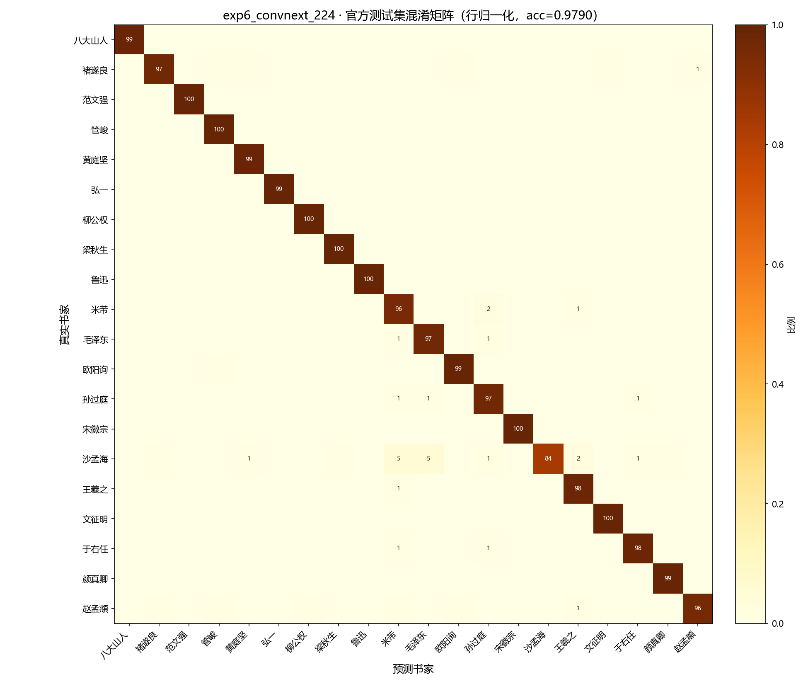

# 中国历代书法名家风格分类

基于 PyTorch 的 20 类中国历代书法名家单字图像分类：从数据体检、预处理规范、模型训练，到 Flask 网页演示与消融实验的完整工程。



## 任务与数据

| 项目 | 说明 |
|---|---|
| 数据规模 | 105,029 张单字图，20 类书家，train 84,022 / test 21,007 |
| 图像规格 | 64×64 RGB，白底黑字 |
| 类别不均衡 | 最多 6,763（范文强）/ 最少 1,075（褚遂良）= 6.29× |
| 训练/验证 | train 再按 9:1 分层切分出 val（75,619 / 8,403，seed=42） |

> 数据与权重体积过大（约 2 GB），未入库；`data/`、`checkpoints/` 已在 `.gitignore` 中忽略。

## 方法

**预处理（训练/推理共用一套）**

1. 黑底（拓片）自动检测 → 反色 → 全局 Otsu + 形态学闭运算填实笔画
2. 白底照片：纸面亮度归一化（去阴影）→ 自适应阈值（窗口 = 4.5× 笔画宽，避免粗笔画被掏空）
3. 去页框 / 米字格虚线 / 碎屑（按尺寸分级，小图不套用去线规则）
4. 紧致外接框 → 字幅固定 88% → 居中补白
5. （网页入口）填掉面积 < 0.15% 的孤立白色孔洞，再 64×64 往返一次低通

**训练**

- ResNet18 / ResNet18-CBAM / ConvNeXt-Tiny 三种骨干
- AMP 混合精度 + AdamW + CosineAnnealingLR + label smoothing 0.1
- 按 val Macro-F1 保存最优、早停（patience 6）
- 禁用水平翻转（书法字形不可镜像）

## 实验结果

| 实验 | 骨干 | 输入 | 官方对齐 Top-1 | 模拟手机 Top-1 |
|---|---|---|---|---|
| exp1_resnet18_base | resnet18 | 128 | **0.9929**（原生口径） | — |
| exp2_domain_aligned | resnet18 | 128 | 0.9726 | 0.2945 |
| exp2b_coverage | resnet18 | 128 | 0.9688 | 0.2740 |
| exp3_hflip_bad | resnet18 | 128 | 0.9678 | **0.1875** |
| exp4_resnet18_cbam | resnet18_cbam | 128 | 0.9662 | 0.2670 |
| exp5_convnext_tiny | convnext_tiny | 128 | 0.9817 | 0.3610 |
| **exp6_convnext_224** | convnext_tiny | 224 | **0.9859** | **0.3870** |

主要结论：

- **水平翻转是有害的**：exp3 在模拟手机集上只有 18.75%，全场最差
- **骨干与分辨率是唯一稳定收益**：resnet18@128 → ConvNeXt@128 → ConvNeXt@224
- **域对齐让口径更诚实**：官方从 99.29%（同源扫描件红利）降到 97~98.6%
- **仍未解决**：模型存在「墨迹密度捷径」，对纯几何图形仍会给高置信度书家判断

## 网页演示

```bash
python app.py            # http://127.0.0.1:5000
```

- `GET /` 页面、`GET /models` 模型列表、`POST /predict` 上传识别
- 模型启动时只加载一次；每次请求留档到 `outputs/web_test/<时间>_<序号>/` 并写 `results.csv`
- 页面附带免责说明与低置信度提示（< 55%）

## 目录结构

```
├─ app.py                Flask 演示服务
├─ index.html            前端页面
├─ train.py              训练主脚本
├─ models/networks.py    网络定义（resnet18 / +CBAM / convnext_tiny）
├─ utils/
│  ├─ dataset.py         Dataset / DataLoader / 增强 / 域对齐缓存
│  └─ preprocess.py      训练与推理共用的归一化
├─ scripts/              体检、缓存、评测、混淆矩阵、Grad-CAM、诊断、报告
└─ docs/                 结果图
```

## 复现

```bash
pip install -r requirements.txt

# 训练（例：exp6）
python train.py --exp_name exp6_convnext_224 --model convnext_tiny \
    --img_size 224 --epochs 30 --batch_size 16 --lr 2e-4 \
    --domain_align --class_weight

# 评测 / 混淆矩阵 / Grad-CAM
python scripts/eval_model.py --exp exp6_convnext_224 --arch convnext_tiny --img_size 224
python scripts/finalize.py
```

## 诊断脚本

- `scripts/diagnose_60pt_drop.py`：定位「官方 98.6% → 模拟手机 38.7%」的掉点来源（同字对比、分布统计、A/B/C 盲测）
- `scripts/xue_debug.py`：单字定点对照，比较 4 种预处理组合下的 Top-5

## License

仅用于学习与研究。数据集版权归原出处所有。
